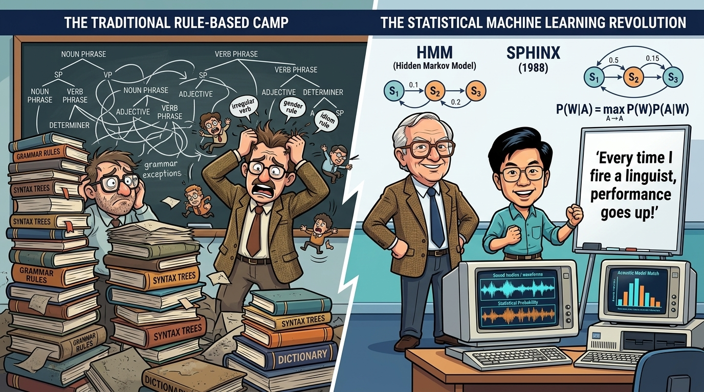

# 【AI】小白话系列——人工智能简史（五十四）

当我想要重新捡起这个搁浅了超过半年的写作主题时，发现了几个重要的遗漏。

首先是 [2005 年 DARPA 荒野挑战赛](20250821【AI】小白话系列——人工智能简史（二十）.md)之后到[2012 年 AlexNet 的惊天突破](20250901【AI】小白话系列——人工智能简史（二十一）.md)之间那 7 年，被我不经意地略过了。读过[李飞飞的自传](https://weread.qq.com/book-detail?v=76c32a50813ab9e4fg01737b)[《我看见的世界》](https://book.douban.com/subject/36672955/)之后，我有点意识到，这 7 年里其实还是颇有些东西值得说说。不然的话，我所开辟的那条写到[2016年的GPU 支线](20250925【AI】小白话系列——人工智能简史（二十八）.md)其实接不上2012 年李飞飞所说的 2012 三大基石会师这个关键节点。

接着，在我想要补齐这关键的 7 年时，我发现还有一个问题需要解决：

在这波人工智能爆火之前，为什么搞人工智能的都说自己在搞「机器学习」？这个名头到底哪里来的？

所以，我只好继续把时间线再往前推。先试着弄明白，为什么一开始[人工智能是两大流派——符号派和连接学派](20250714【AI】小白话系列——人工智能简史（九）.md)，在 90 年代后期却变成了斯坦福三大学派：

1. 逻辑与符号（Logical / Symbolic）
2. 统计与概率（Statistical / Probabilistic ML）
3. 连接与神经网络（Neural / Connectionist）

中间这一学派的开端，正是我在[寒冬里的火种](20250731【AI】小白话系列——人工智能简史（十五）.md)提到过的李开复。就是那个做过微软研究院老大，被 Google 的佩奇与布林直接挖走，敲定「谷歌」中文名，自诩为大学生导师，创办了创新工场；又在战胜癌症之后重返 AI 创业一线创办零一万物的李开复。

起初，IBM 语音识别团队的灵魂人物 Fred Jelinek 顶着主流语言学家的嘲讽，坚持用香农信息论与隐马尔可夫模型（HMM）直接拟合海量语料。他有句名言流传极广：

> **"Every time I fire a linguist, the performance of the speech recognizer goes up."**
>
> （我每开除一个语言学家，语音识别系统的性能就会提升一次。）

这不仅仅是一句玩笑话，而是第一次指出这样一个残酷的事实——计算机的能力每发展到一定程度，就会在某一个领域出现从工程和成本上碾压人类专家的现象。这一次，是人类语言专家定义的规则存在主观偏见、难以覆盖长尾边界、扩展代价极高，以至于在成本和能力上输给完全由统计概率模型和海量真实文本驱动的计算机。将来还有一次又一次，这是后话。

先说回 1988 年，当时正读博士的李开复，继续在 HMM 概率统计这条路上，搞出全球第一个既能实现大词汇量，又能针对非特定人，并且还能连续语音识别的实用系统 SPHINX，彻底终结了语音识别这个领域的语言学家专家规则。

随后，IBM 的 Peter Brown，Vincent Della Pietra 等人将同样的思路移植到了机器翻译。1993 年，在论文[The Mathematics of Statistical Machine Translation: Parameter Estimation](https://aclanthology.org/J93-2003.pdf) 里，他们提出了划时代的香农信道噪声模型（Noisy Channel Model），奠定了统计机器翻译（SMT）长达二十余年的统治地位。

同样的，在计算机生物学界，Anders Krogh 等人也吸收了业界在语音识别上使用 HMM 框架的灵感，在 1994 年提出用于蛋白质序列建模的 Hidden Markov Models，并且在 1998 年出版了生物序列分析的圣经《[生物序列分析：蛋白质与核酸的概率模型](http://eddylab.org/cupbook.html) 》。

不止是 HMM 和 SMT，到了 90 年代中期，统计学派其它几个分支也在不同的领域落地，并牢牢占据了主导地位。比如，贝叶斯网络（Bayesian Networks / 概率图模型）被用在复杂医疗的辅助诊断和专家决策系统中，朴素贝叶斯则被大量应用在垃圾邮件过滤、门户网站目录树收录和路透社新闻电讯自动分类和路由中。

话说，贝叶斯这个概念，理论上我在读大学时的《统计与概率》这门课就学过，但考完试我就忘干净了。直到后来我开始用张小龙的 Foxmail，在某次版本更新后，我发现了菜单里多了个用贝叶斯过滤垃圾邮件的开关。点开一试，惊喜地发现，那些不胜烦扰的垃圾邮件，就此几乎彻底地安静了下来。

最近爆火的所谓 Jev ——所谓「系统一」文本路由模型 / 框架——和当年朴素贝叶斯解决的其实是同一个工程问题——**高速、低成本把文本归类到预定义槽位，好让后续业务走向不同分支**。

所以，我们可以从朴素贝叶斯入手，了解一下从技术原理的角度来说，90 年代的统计学派究竟干成了什么。

<待续>