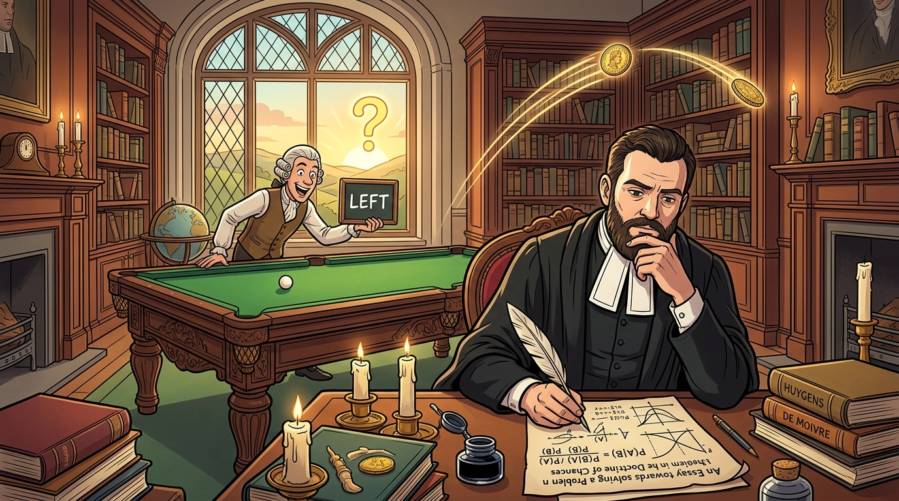

# 【AI】小白话系列——人工智能简史（五十五）

说到贝叶斯，不得不先了解一下贝叶斯这个人——西方科学的命名方法有这点好处，你会不由自主地把创始人找出来，摸一下某个理论的历史脉络。

[贝叶斯（Thomas Bayes）](https://en.wikipedia.org/wiki/Thomas_Bayes) 不是科学家，他只是 18 世纪英国的一位长老会牧师。当时，哲学家休谟（David Hume）提出了著名的怀疑论——

> **不管你多少次看到太阳升起，也无法从逻辑上必然证明太阳明天还会升起。**

作为一个牧师，贝叶斯当然想反驳，而且要从数学角度来进行论证严密的反驳。于是，他开始思考：

> 怎么根据人类在自然界有限的观测现象，在数学上反向证明上帝的存在与必然性呢？

他设计了一个思想实验：

> 放一张背对着观察者的台球桌。侍从随机扔下一颗白球。
>
> 随后，侍从不断扔下其他球，但绝不告诉观察者新球的具体位置，只说它落在白球左侧还是右侧。虽然观察者永远看不到白球在哪里，但他能不能根据侍从一次次汇报的信息，一步一步逼近白球的真实坐标呢？

这个问题他想了一辈子，始终觉得不够严密。直到他 1761 年去世后，他的好友[理查德·普莱斯（Richard Price）](https://en.wikipedia.org/wiki/Richard_Price) ———一位牧师兼哲学家——在整理他遗物时发现了手稿，然后推动英国皇家学会把这篇「反击无神论的数学武器」正式发表了出来。这就是——[《机会学说中一个问题的解法 An Essay towards solving a Problem in the Doctrine of Chances》](https://en.wikipedia.org/wiki/An_Essay_towards_solving_a_Problem_in_the_Doctrine_of_Chances)。

这个问题，他是这样描述的：

> **Given the number of times in which an unknown event has happened and failed: Required the chance that the probability of its happening in a single trial lies somewhere between any two degrees of probability that can be named.”**   

> *大意：已知某个未知事件在若干次试验中成功与失败的次数：求该事件在单次试验中发生的真实概率，落在任意指定的两个概率值之间的机会有多大。*

过去，数学家们都是在研究正向问题，比如：

> 已知硬币抛出正面的概率是 50%，如果连抛 10 次，出现 7 次正面的概率有多大？（从因到果）

现在，贝叶斯第一次把这个思考方式彻底倒了过来：

> 我不知道这个硬币有没有做手脚，但我亲眼看见它连抛 10 次，7 次正面，3 次反面。那么：这枚硬币抛出正面的概率在 60% - 70% 之间的可能性有多大？（从果到因）

这或许是人类第一次尝试从数学上证明和表达，那些根植于脑海中的必然信念，比如：

* 硬币抛出正面 / 反面的概率就是一半一半
* 太阳明天会照常升起

它们的真实可信度究竟是多少？

由于当时没有现代的数学积分工具，贝叶斯用那个基于台球的物理实验，用几何面积计算把概率表达了出来。但真正把这套理论框架用现代数学工具搭建起来的，却是在 10 多年后，另一位完全没看过这份手稿的数学大家手中。

<待续>
