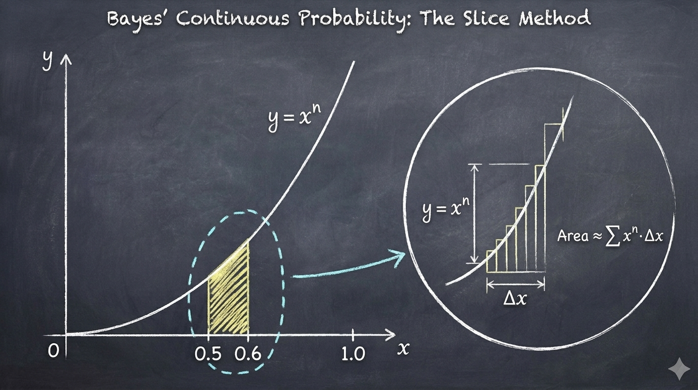

# 【AI】小白话系列——人工智能简史（五十七）

上次我们说到，拉普拉斯老爷子（其实，那时候只是个小伙子）写出的贝叶斯公式，成为了 200 年后朴素贝叶斯算法的核心骨架——除了一点点朴素的小补丁——这个我们之后再研究。

贝叶斯——这是个真正的老爷子——留下手稿的初衷是用数学工具，来捍卫被休谟怀疑论所动摇的造物主信仰。而拉普拉斯，则是牛顿机械决定论的坚定拥趸。所以，当年拿破仑翻阅了他厚厚的《天体力学》后，质问他为啥著作里竟然一次都没有提及伟大的造物主时，拉普拉斯淡然地回答：

> **“Sire, je n'avais pas besoin de cette hypothèse.”**
>
> **（陛下，我不需要那个假设。）**

动机虽然不同，拉普拉斯却同样在琢磨明天太阳会不会照常升起——

> 如果某种现象（比如太阳每天早上照常升起）在人类有史以来已经发生了 $$n$$  次，从未失败。那么，明天它第  $$ n+1 $$ 次依然发生的概率，到底是多少？

按照之前的古典算法：

* 明天成功的概率： $$\frac{n}{n} = 100\%$$
* 明天不成功的概率：$$\frac{0}{n} = 0\%$$

要么百分百确定，要么完全没可能——这显然有点荒谬。如果人类真的是用这样的方法认知世界，那么任何一件从未见过的全新事实（比如见到一只黑天鹅），都会被判定为「**绝对不可能发生**」。人类也就不可能持续进步，一步一步走到今天了。

让我们试着用这个被共同探讨过的问题，把贝叶斯老爷子和「小伙子」拉普拉斯各自走过的路再理解一遍。贝叶斯想用太阳继续升起的概率来论证上帝的存在，而拉普拉斯则认为，有没有上帝，太阳继续升起的概率都是一个可计算的定数。我们取两人的最大公约数，把这个问题的说法换成这样：

> 假设「上帝」每天早上都会掷同一枚硬币，正面就让太阳继续升起，背面就不让太阳升起。
>
> 而这枚硬币出现正面的概率是在 $$ 0 ～ 1 $$ 之间的固定值： $$ x $$ 。但 $$ x $$ 具体等于多少，只有上帝知道。
>
> 我等凡人已知的是：人类有史以来（假设有记录的文明以一万年计，一共三百六十五万天吧），太阳天天照常升起。
>
> 那么问题来了：明天太阳会继续升起吗？

这个问题，比我们之前学习拉普拉斯离散贝叶斯公式时更进了一步。上帝手里这枚硬币出正面的概率，不再是从$$0\%$$、$$50\%$$、$$100\%$$ 之间三选一，而是在 $$ 0 ～ 1 $$  之间那无穷多个数字里任选其一。 

怎么算呢？

刚开始，贝叶斯和拉普拉斯的算法没有任何区别，既然硬币抛出正面的概率是 $$ x $$ ，那么连续抛出 $$n$$ 次正面，这件事儿发生的概率就是：

$$P(\text{连续 } n \text{ 次正面} \mid x) = x \cdot x \dots x = x^n$$

要接着往下计算，可怜的贝叶斯老爷子手头却没有我们上学时学的那套好用的积分工具（这事儿说到底还得怪牛顿和骄傲的英国皇家学会），于是他极具巧思地把问题转换成计算台球桌上的面积比例，就是前面聊过的那个扔白球、黑球的思维试验：

1. 如果  $$ x = 1 $$  ，那么连续 n 次观察到太阳升起的概率 $$ x^n = 1 = 100\% $$ 
2. 如果  $$ x = 0 $$  ，那么连续 n 次观察到太阳升起的概率 $$ x^n = 0 = 0\% $$ 
3. 如果  $$ x = 0.5 $$  ，那么连续 n 次观察到太阳升起的概率 $$ x^n = 0.5 ^ n $$
4. 如果  $$ x = 0.6 $$  ，那么连续 n 次观察到太阳升起的概率 $$ x^n = 0.6 ^ n $$

虽然 X 落在某个精确点的概率是没有意义的 $$ 0 $$，但落在某个区间，比如 0.5 - 0.6 之间的概率，还是可以用计算曲线面积的方法算出来的。

再加上，牛顿早就证明， 计算 $$ y = x^n $$ 的面积，可以直接使用这个公式： $$ S_n = F(x) = \frac{x^{n+1}}{n+1} $$

所以，X 落在 0.5 和 0.6 之间的概率就可以像下面这样计算：

$$P(0.5 \le x \le 0.6) = \frac{\text{局部面积}}{\text{总面积}} = \frac{S_{[0.5,0.6]}}{S_{[0,1]}} = \frac{F(0.6) - F(0.5)}{F(1)-F(0)} $$

结合上面这张切片面积图的例子，我们或许能回忆起高中时学过的那套方法，理解贝叶斯老爷子用面积比例算概率的巧思。但是，想要直观感受一下，上帝的这枚硬币有多么极端，让我们试着把目光聚焦最最靠右的边缘，算算 $$ x $$ 落在 0.9 - 1.0 这个极致边缘区间的概率吧。还是一模一样的公式：

$$P(0.9 \le x \le 1.0) = \frac{\text{局部面积}}{\text{总面积}} = \frac{S_{[0.9,1.0]}}{S_{[0,1]}} = \frac{F(1.0) - F(0.9)}{F(1)-F(0)} = \frac{\frac{1.0^{n+1} - 0.9^{n+1}}{n+1}}{\frac{1^{n+1} - 0}{n+1}} = 1 - 0.9^{n+1}$$

* 当我们一天都没有观察过， $$ n=0 $$  时， $$ x $$ 落在 0.9 - 1.0 区间的概率$$P(0.9 \le x \le 1.0) = 1 - 0.9^{0+1} = 10 \%$$   （这个好理解，啥都不知道时就假装一切均匀分布）
* 当我们连续两天看到太阳升起， $$ n=2 $$  时， $$ x $$ 落在 0.9 - 1.0 区间的概率立刻变成了$$P(0.9 \le x \le 1.0) = 1 - 0.9^{2+1} = 27.1 \%$$   
* 而当算上人类有史以来上万年的证据， $$ n=3650000 $$  时， $$ x $$ 落在 0.9 - 1.0 区间的概率立刻变成了$$P(0.9 \le x \le 1.0) = 1 - 0.9^{3650000+1} \approx 99.999... \%$$ （小数点后约莫17万个9，几乎绝对等于 $$100\%$$）   

这就是贝叶斯老爷子当年的推演结果，但是他为啥到死都不肯发布呢？小伙子拉普拉斯又是怎么算的呢？

<待续>