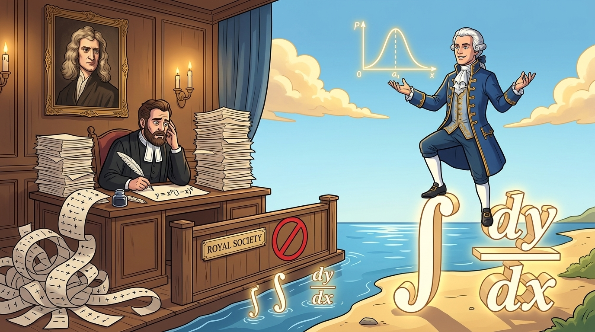
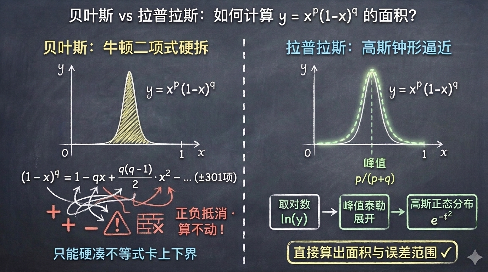

# 【AI】小白话系列——人工智能简史（五十八）

上次说到贝叶斯老爷子为啥一直到死都没肯发布自己的推演结果。有两个原因，其中一条就是我们提到过的——得怪牛顿和骄傲的英国皇家学会。

莱布尼茨和牛顿各自发明了微积分，莱布尼茨后想出来，却先发表了，还顺手发明了至今还在用的优雅符号：

 **$dy / (dx)$    和积分号 $∫$**    

然后牛顿门徒和莱布尼茨吵了起来。正是牛顿本人，在他执掌英国皇家学会会长的 24 年里，亲手组建了「独立调查委员会」，亲自执笔写报告，把莱布尼茨定性为抄袭者。这之后，因为死要面子，英国人抵制来自欧洲大陆莱布尼茨的积分符号，长达几乎整整一百年。

可怜的贝叶斯老爷子（1701-1761）正好活在这英国自我封闭的时间窗里。当他想把之前的太阳问题推广到更通用的场景——假如成功了 $p$ 次，然后失败了 $q$ 次时，他也只能老老实实用牛顿式的面积法硬算。

但这时，曲线从 $$ y = x^n $$ 变成了 $$ y = x^p (1-x) ^q $$。

没有现成的积分公式，他只能用牛顿二项式展开硬凑硬算。然而这个计算量，随着 $p$ 和 $q$ 的变大，急剧上升。我请 Gemini 帮我画了一张图，大家可以看到，正负交替的巨大数字互相抵消，只要稍微算错一点点，整个结果就全盘报废。也就是说，在那没有计算机的 18 世纪，靠着羽毛笔和羊皮纸，一旦 $p$ 和 $q$ 超过 100，就几乎不可能进行有效的计算了。更别说，要考虑人类有史以来、那百万量级的观测结果。

这只是其一。

此外，还有第二个原因：大家不知是否还记得，根据之前的公式，当一次观察都没有，啥都不知道时：

* **概率是均匀分布的**

我们现在觉得理所应当，但贝叶斯对此心虚不已：凭啥这种情况下，概率就是均匀分布的呢？

于是乎，因这两个心结未解，可能有点完美主义倾向的贝叶斯，终其一生也不肯发布自己的推演结果。

拉普拉斯不一样，他生在法国，长在法国，从出生起就站在莱布尼茨的肩膀上。先画张图吧，下次展开说。

  

<待续>