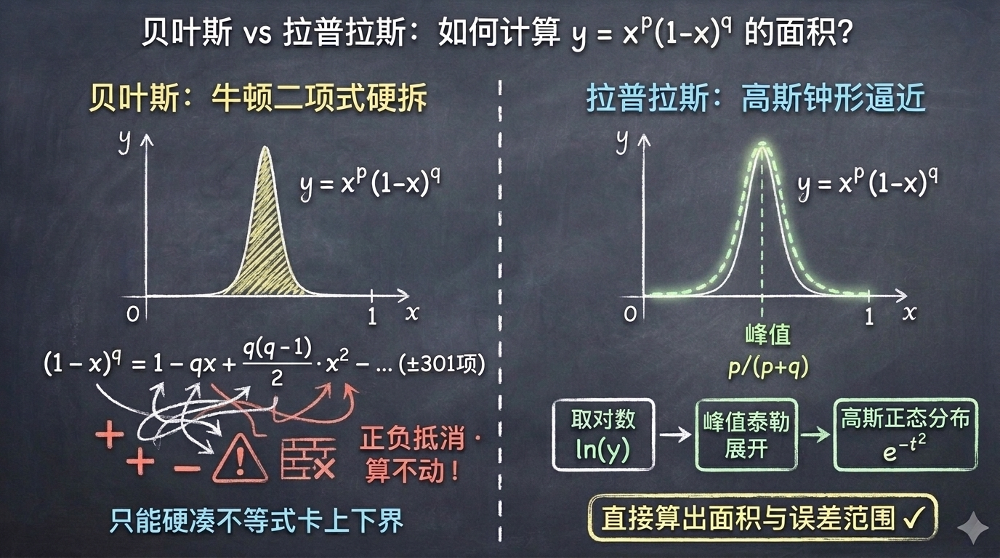
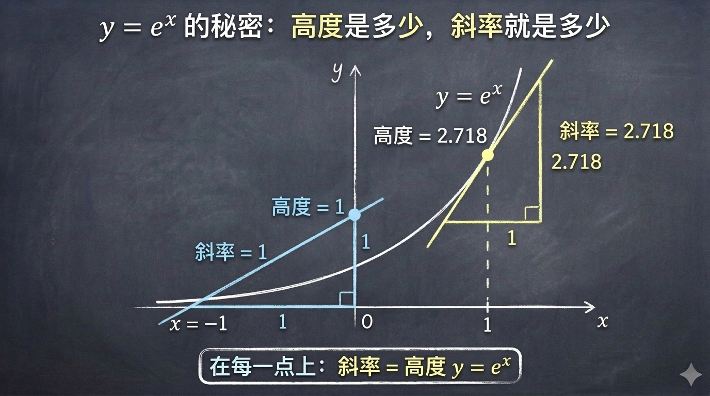
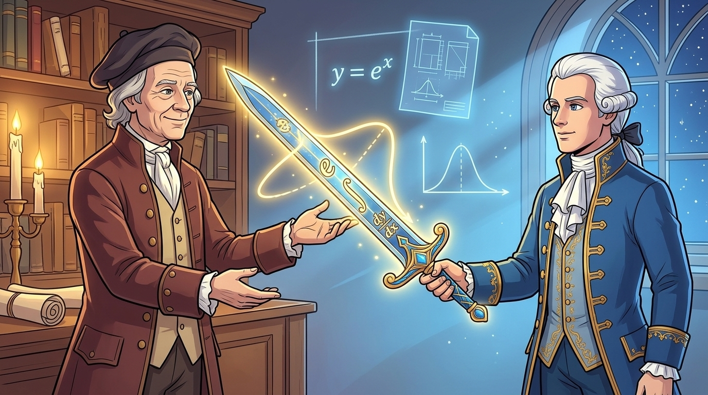

# 【AI】小白话系列——人工智能简史（五十九）

顺着上次 Gemini 帮忙画的这张图，我们来看看拉普拉斯手握传承自欧拉、莱布尼茨的工具，是怎么做的：

拉普拉斯曾经说过一句名言：

> **读欧拉，读欧拉，他是我们所有人的老师。**

这不由得让我想起芒格在南加州大学法学院毕业典礼上说的那句：

> My sword I leave to him who can wear it.
>
> 我的剑留给能够挥舞它的人

显然，拉普拉斯拿到了欧拉传给他的「宝剑」—— 可那究竟是些什么呢？我们还得顺着欧拉的线索再往前找。

其实，莱布尼茨当年不仅发明了 **$\frac{dy}{dx}$ 和 $\int$**，还在研究切线问题时，摸到了一个神奇常数 $2.71828...$ 的门槛。这个数字的神奇之处就在于，$y=2.71828...^x$ 的斜率（增长率）永远等于它自己。这也是瑞士的雅各布•伯努利计算利滚利极限找到的同一个神奇数字。

而欧拉，给这个神奇常数起了个好名字—— $e$。接着，就用莱布尼茨那套微分和积分符号，把  $e^x$ 和 $ln(x)$ 变成了数学家的常用工具。

对了，欧拉还把泰勒展开用微分和积分符号重新翻译了一遍。 

泰勒是个英国人，牛顿那一派的。在他那个时代，复杂的函数曲线，比如 $ln(x)$、$sin(x)$、$e^x$ 这些，用纸笔很难计算。人类处理的极限，就是只带加减乘除和次方的多项式，像下面这样的：

$$ a_0 + a_1 x + a_2 x^2 + \dots $$

泰勒想出来一个巧妙的办法，站在曲线的某个已知点上，一层一层对齐特征，用多项式曲线来模仿这条曲线：

1. 位置对齐：在这一点，多项式曲线和原曲线的高度一模一样；
2. 方向对齐：在这一点，多项式曲线和原曲线的斜率一模一样（也就是一阶导数）；
3. 曲率对齐：多项式曲线往哪边转弯、转弯有多急和原曲线对齐，也就是二阶导数；
4. ……如果还嫌不够准确，就一层又一层，三阶、四阶、五阶……一路对齐过去，直到够用为止。

可惜泰勒用的是牛顿流数符号，英国人自己大多看得云里雾里，根本不知道怎么用。反而是到了欧拉手里，用微积分那套符号语言翻译之后，才变成了欧洲数学家人人可用的武器。

这还不算完，除了微积分和泰勒展开，欧拉手里还有几样厉害的兵器传了下来。

<待续>